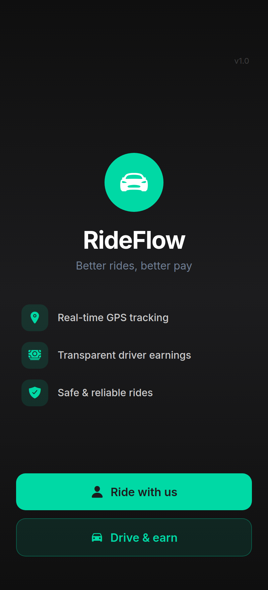
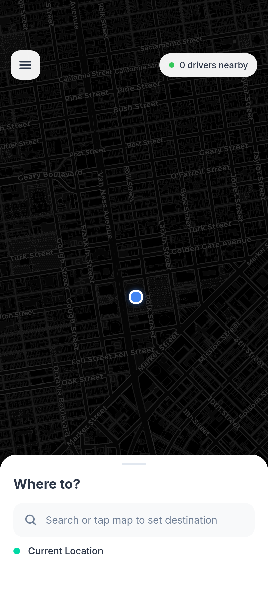
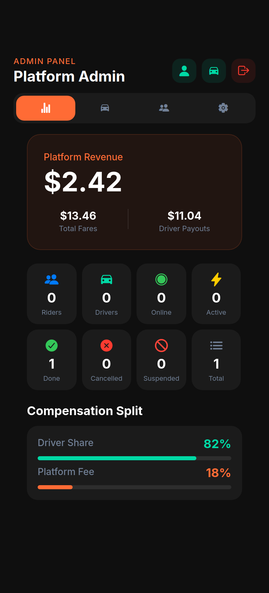
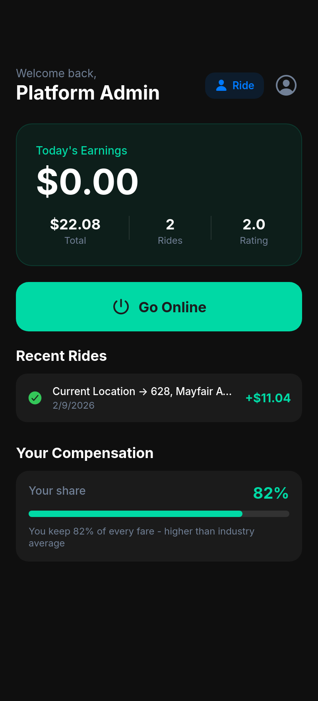
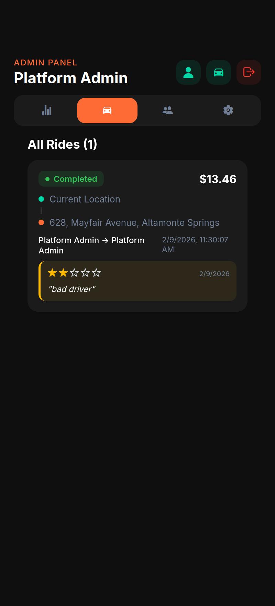
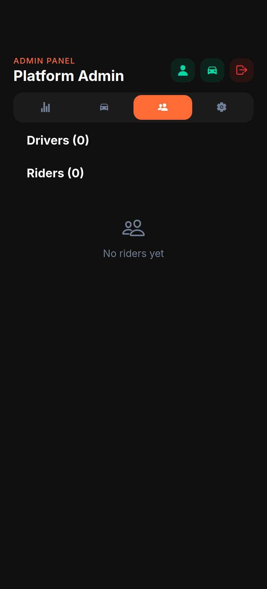
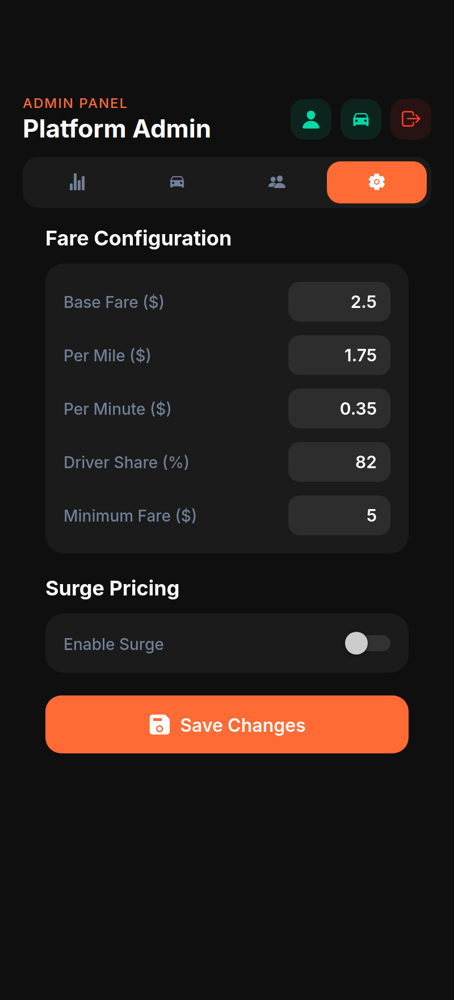
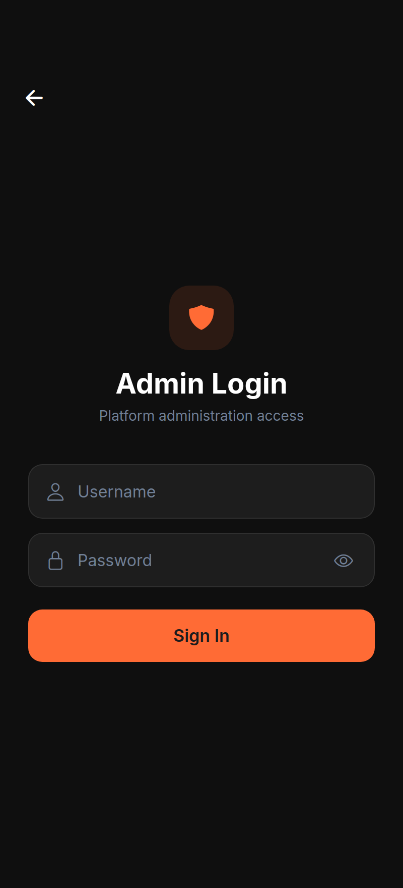

<div align="center">

#  RideFlow

### Better rides, better pay.

**An open-source ride-sharing platform where drivers keep 82% of every fare.**

Real GPS. Real maps. Real transparency. Built for iOS, Android, and the web from a single codebase.

<br/>


<br/>





</div>

---

##  Why RideFlow?

Most ride-hailing apps hide how the money is split. RideFlow does the opposite — **every fare is transparent, and drivers keep 82% by default** (the platform fee is fully configurable from the admin panel). It ships with three real, role-aware experiences and uses native device capabilities instead of mock data.

-  **Real maps & GPS** — `react-native-maps` on mobile, Leaflet/OpenStreetMap on web, live location via `expo-location`.
-  **Transparent compensation** — riders, drivers, and admins all see exactly how a fare breaks down.
-  **Three real roles** — riders ride, drivers drive *and* ride, admins run the whole platform.
-  **Ratings & reviews** — star ratings with private, admin-only review notes.
-  **One codebase, three targets** — iOS, Android, and web from a single Expo project.
-  **Durable by default** — Redis with append-only-file persistence; data survives restarts.

---

## 📱 Screens

### The rider experience
Riders get a clean, map-first interface: see nearby drivers, drop a pin, and book a ride.

<div align="center">


</div>

### The driver experience
Drivers see **today's earnings**, go online with one tap, and — crucially — see exactly what share of every fare they keep.

<div align="center">

</div>

### The admin control center
A hidden super-admin panel (revealed via a 5-tap on the version label) with platform revenue, live fleet stats, ride history, user management, and a fully configurable fare engine.

<div align="center">




</div>

### Secure access
Role-aware login, with administration access kept out of the way of everyday users.

<div align="center">

</div>

---

##  Architecture

```
┌──────────────────────────────┐         ┌──────────────────────────────┐
│   Expo / React Native app     │  REST   │      Express.js backend       │
│   (iOS · Android · Web)       │ ◄─────► │      (TypeScript, tsx)        │
│                               │  JSON   │                               │
│  • Expo Router (file routes)  │         │  • Auth, rides, fares, events │
│  • React Query (server state) │         │  • Static landing page        │
│  • React Context (auth)       │         │            │                  │
│  • AsyncStorage (persistence) │         │            ▼                  │
│  • react-native-maps / Leaflet│         │   ┌────────────────────┐      │
└──────────────────────────────┘         │   │  Redis (AOF persist)│      │
                                          │   └────────────────────┘      │
                                          └──────────────────────────────┘
```

- **Frontend** keeps as much logic as possible client-side; the backend is a thin persistence + API layer.
- **Backend** auto-starts a local Redis instance with AOF persistence on boot — no separate DB to provision in dev.

---

##  Tech Stack

| Layer | Technology |
|------|------------|
| App framework | Expo SDK 54 · React Native 0.81 · React 19 |
| Routing | Expo Router (file-based) |
| Server state | TanStack React Query |
| Local state | React Context + AsyncStorage |
| Maps | `react-native-maps` (mobile) · Leaflet + OpenStreetMap (web) |
| Location | `expo-location` (native) · Web Geolocation API |
| Backend | Express 5 · TypeScript · `tsx` |
| Data store | Redis (`ioredis`) with append-only-file persistence |
| Validation | Zod + shared schema (`shared/schema.ts`) |
| Typography | Inter (Google Fonts) |

---

## 🚀 Getting Started

### Prerequisites

- **Node.js 20+**
- **Redis** available on your machine (the backend will auto-start `redis-server` on `127.0.0.1:6379` if it's installed and on your `PATH`)
- **Expo Go** app on your phone (optional, for testing on a physical device)

### 1. Install dependencies

```bash
npm install
```

### 2. Configure environment

```bash
cp .env.example .env
# Edit .env if you need to change the port or backend URL.
```

### 3. Start the backend

```bash
npm run server:dev
```
The Express server boots on **port 5000**, starts Redis, and seeds the admin account on first run.

### 4. Start the app

In a second terminal:

```bash
npm run expo:dev
```

- Press **`w`** to open the web app, or
- Scan the QR code with **Expo Go** to run it on your phone.

> The frontend talks to the backend via `EXPO_PUBLIC_DOMAIN` (default `localhost:5000`). When testing on a physical device, set it to your machine's LAN address, e.g. `EXPO_PUBLIC_DOMAIN=192.168.1.20:5000`.

---

##  Default Credentials

On first boot the backend seeds a single super-admin account:

| Role | Username | Password |
|------|----------|----------|
| Admin | `admin` | `admin123` |

> **Change this immediately for any real deployment.** Riders and drivers register themselves through the app's sign-up flow.

To reach the admin login: on the welcome screen, **tap the version label (`v1.0`) five times** to reveal the hidden admin entry.

---

##  Role Hierarchy

- **Riders** — ride only. Map, booking, live tracking, and post-ride reviews.
- **Drivers** — drive **and** ride. Earnings dashboard, online/offline toggle, ride acceptance & navigation, plus a one-tap switch into rider mode.
- **Admins** — full platform control: stats, ride oversight, user management (suspend/delete), and the fare engine. Admins can also view the platform as a driver or rider.

---

##  Fare & Compensation

Fares are computed from a configurable model (editable live in **Admin → Settings**):

| Parameter | Default |
|-----------|---------|
| Base fare | $2.50 |
| Per mile | $1.75 |
| Per minute | $0.35 |
| Minimum fare | $5.00 |
| **Driver share** | **82%** |
| Surge pricing | Toggle |

The remaining 18% is the platform fee — change the **Driver Share %** to whatever your business model requires.

---

##  Project Structure

```
rideflow/
├── app/                  # Expo Router screens (file-based routing)
│   ├── index.tsx         # Welcome / role selection (hidden admin 5-tap)
│   ├── login.tsx         # Role-aware login
│   ├── register.tsx      # Registration
│   ├── rider.tsx         # Rider interface (map, booking, tracking)
│   ├── driver.tsx        # Driver dashboard (earnings, rides, navigation)
│   └── admin.tsx         # Admin control center
├── components/           # Shared UI (maps, modals, error boundary, ...)
├── constants/            # Theme colors
├── lib/                  # Auth context + API/query client
├── server/
│   ├── index.ts          # Express bootstrap + CORS
│   ├── routes.ts         # All REST endpoints
│   ├── storage.ts        # Redis-backed storage (IStorage)
│   └── templates/        # Static landing page
├── shared/
│   └── schema.ts         # Shared types & Zod validation
├── docs/screenshots/     # README imagery
├── .env.example
└── LICENSE               # GPLv3
```

---

##  API Reference

**Auth**
- `POST /api/auth/register` · `POST /api/auth/login`

**Users**
- `GET /api/user/:id`
- `PUT /api/user/:id/location` · `PUT /api/user/:id/online`
- `GET /api/drivers/nearby?lat=&lng=&radius=`

**Rides**
- `POST /api/rides` · `GET /api/rides/:id`
- `PUT /api/rides/:id/accept` · `PUT /api/rides/:id/status`
- `GET /api/rides/rider/:id` · `GET /api/rides/driver/:id`
- `GET /api/rides/rider/:id/active` · `GET /api/rides/driver/:id/active`
- `GET /api/rides/available`
- `GET /api/fare/estimate`

**Events**
- `GET /api/events/:userId` · `PUT /api/events/:eventId/read`

**Admin**
- `GET /api/admin/stats` · `GET /api/admin/rides` · `GET /api/admin/users`

---

##  Contributing

Contributions are welcome! Please open an issue to discuss substantial changes before submitting a pull request. By contributing, you agree your contributions will be licensed under the GPLv3.

---

##  License

RideFlow is released under the **GNU General Public License v3.0 (or later)**. See [`LICENSE`](./LICENSE) for the full text.

You are free to use, study, share, and modify this software. If you distribute it or a derivative — including over a network as part of a larger work — you must keep it under the same license and make your source available.

<div align="center">
<br/>
<sub>Built with Expo, Express, and a belief that drivers deserve a bigger slice. </sub>
</div>
